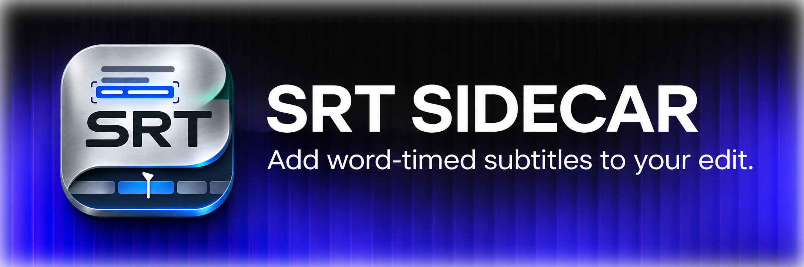
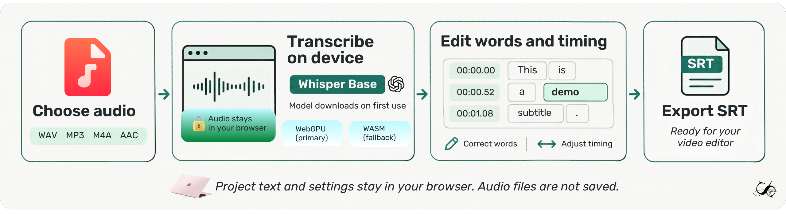

# SRT Sidecar

**Turn audio into editable, word-timed subtitles. Keep the workflow local.**

SRT Sidecar is a browser-based subtitle editor for creators who want an SRT they can actually refine before it reaches the timeline. Pick an audio file, generate a transcript on your device, fix the words and timing, then export.

No account. No audio upload to an SRT Sidecar server.

## What it does

- Transcribes audio locally in a Web Worker with Whisper Base.
- Lets you edit transcript text and adjust cue timing.
- Groups words into subtitle cues and checks SRT timing before export.
- Saves recent project text and settings in IndexedDB. Audio files are not saved.
- Reopens projects for editing or export; reconnect the original audio to resume playback.
- Includes a sample project to explore the editor without downloading the model.

## How transcription works

  

The diagram shows the workflow. Its WebGPU and WASM labels illustrate runtime options; the current app uses quantized WASM directly. It runs [`onnx-community/whisper-base_timestamped`](https://huggingface.co/onnx-community/whisper-base_timestamped) through Transformers.js in a browser worker, using the quantized WASM runtime for consistent desktop and mobile behavior. Model assets download on first use, show aggregate download progress, and are cached by the browser when available. Audio stays on your device.

A local browser check transcribed a 16.7-second MP3 into 68 timed words and exported 68 valid SRT cues. This checks the workflow, not recognition quality. Accuracy across real recordings, speakers, languages, browsers, and devices still needs broader evaluation. [See validation notes](docs/VALIDATION.md).

## Stack

   React&nbsp;&nbsp;
   TypeScript&nbsp;&nbsp;
   Vite&nbsp;&nbsp;
   Transformers.js&nbsp;&nbsp;
   ONNX Runtime Web&nbsp;&nbsp;
   IndexedDB

## Credits and licensing

See [third-party notices](THIRD_PARTY_NOTICES.md) for component, icon, model, and dependency credits. The project uses React Bits Dither, ReactDrops Liquid Glass Logo, and Pikaicons. Review the included ReactDrops component license and the model repository license before redistributing the source or choosing a project-wide license.

  

